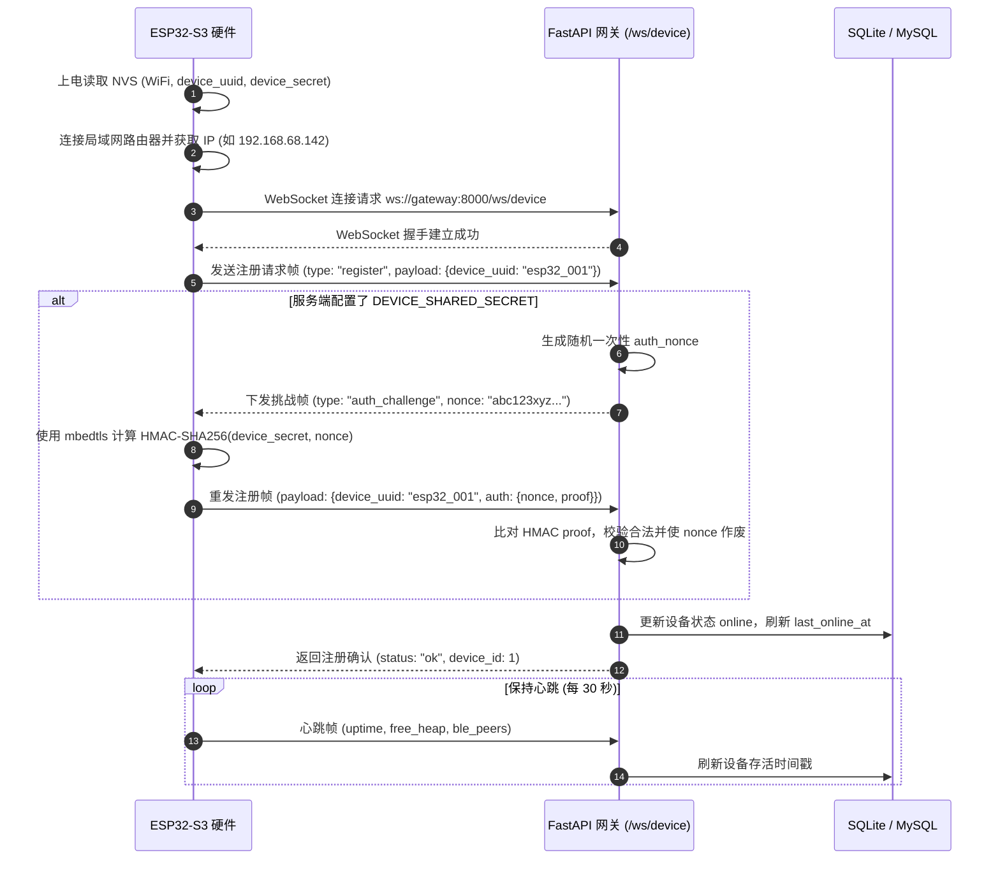
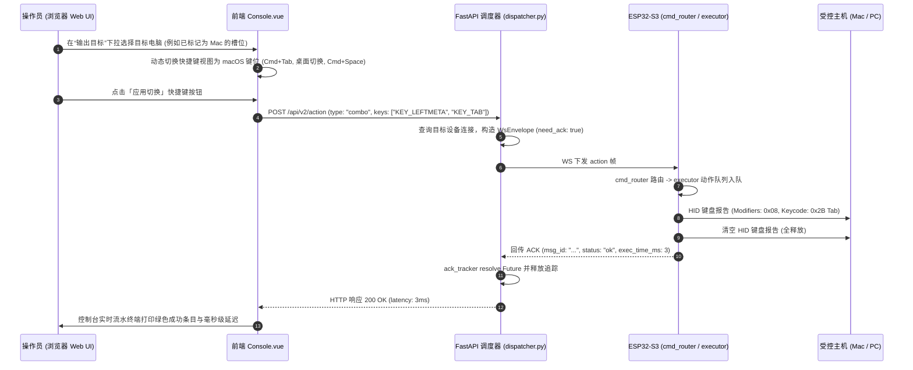
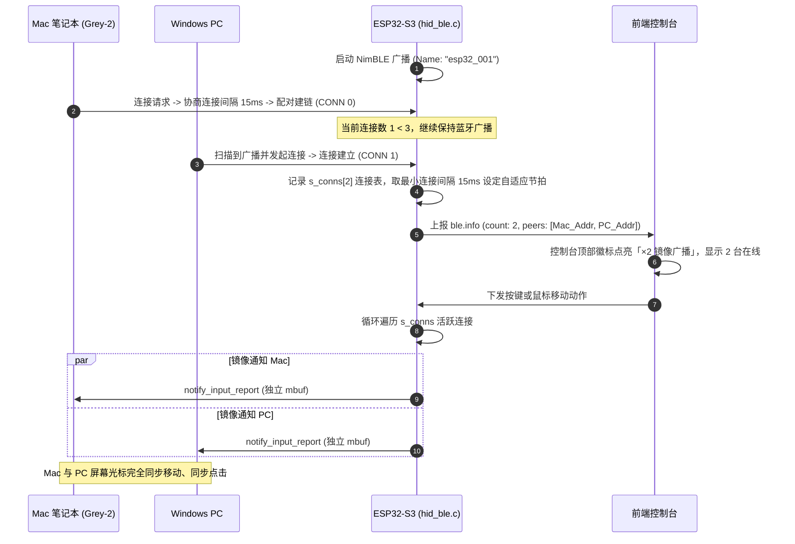
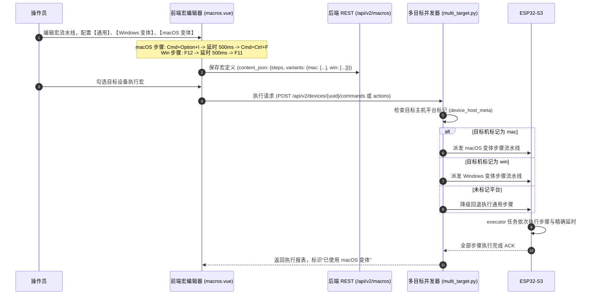
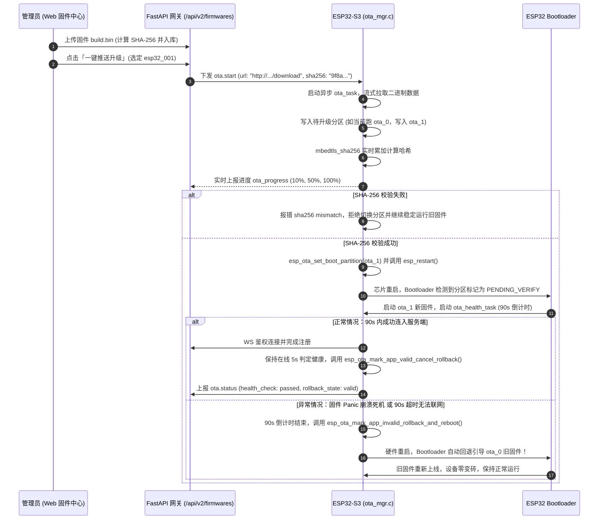

# 核心应用场景与业务交互流程 (User Scenarios & Sequence Flows)

> **文档版本**：V2.1  
> **适用模块**：全链路业务流  
> **编写日期**：2026-10-26  

---

## 1. 场景一：硬件上电配网与长连接安全鉴权

本场景描述 ESP32-S3 设备从物理加电、建立 Wi-Fi 连接，到向后端网关发起 WebSocket 握手并完成 HMAC-SHA256 挑战-应答鉴权的全流程。



---

## 2. 场景二：Web 控制台低延迟击键与平台感知快捷键

操作员在 Web 前端控制台点击机械键帽或系统快捷键，指令通过网关实时投递至受控主机，并根据受控机操作系统自动适配键位。



---

## 3. 场景三：Pointer Lock 真实键鼠流式接管 (1:1 直通)

操作员点击控制台“接管键鼠”面板，浏览器锁定鼠标光标，捕获物理鼠标原始增量与真实键盘按压，高频低延迟直通受控机。

```mermaid
sequenceDiagram
    autonumber
    participant Mouse as 操作员物理鼠标
    participant Browser as 浏览器 (PointerLockPanel)
    participant Server as 后端网关 (/ws/client)
    participant ESP as ESP32-S3 (hid_usb.c)
    participant Host as 受控电脑

    Browser->>Browser: 请求 requestPointerLock(unadjustedMovement: true)
    Mouse->>Browser: 鼠标极速甩动 (连续产生 mousemove 事件)
    Browser->>Browser: 10ms 聚合缓冲微批处理 (合并 dx, dy, 超 ±127 自动分片)
    Browser->>Server: WebSocket /ws/client 发送 mouse_move (二进制/精简信封)
    Server->>Server: dispatcher 识别流式动作：跳过数据库落库，直接转发
    Server->>ESP: /ws/device 高频下发 mouse_move (dx, dy)
    ESP->>ESP: dx, dy 累加至 pending 增量缓冲 (临界区保护)
    
    alt TinyUSB 中断端点空闲
        ESP->>Host: tud_hid_n_report 发送鼠标报告
    else 端点忙 (上一报告未轮询走)
        ESP->>ESP: 增量保留在 pending 缓冲中
        Host-->>ESP: tud_hid_report_complete_cb 触发中断回调
        ESP->>Host: 立即补发剩余积压增量 (零丢失)
    end

    Note over Mouse,Host: 按键防丢保障 (s_buttons_dirty)
    Mouse->>Browser: 按下左键并拖拽
    Browser->>Server->>ESP: mouse_down (buttons: 0x01)
    ESP->>ESP: 标记 s_buttons_dirty = true
    ESP->>Host: 随下一次移动报告合并发送鼠标按键按下状态 (支持拖拽，不粘键)
```

---

## 4. 场景四：BLE 多连接镜像广播与定向切换

ESP32-S3 同时与多台电脑（如 Mac 笔记本与 Windows 台式机）建立蓝牙连接，实现一套外设同屏镜像遥控。



---

## 5. 场景五：跨平台宏流水线编排与智能分发

用户创建自动化脚本（例如“打开浏览器控制台并全屏”），由于 Mac 与 Windows 的快捷键差异，宏引擎在运行时根据被控机系统类型自动选取对应变体。



---

## 6. 场景六：双槽 OTA 安全升级与 90 秒自动回滚

管理员在前端页面推送新固件，设备在线下载并校验，若新固件异常无法联网，系统触发自动回滚，确保设备永不失联。


