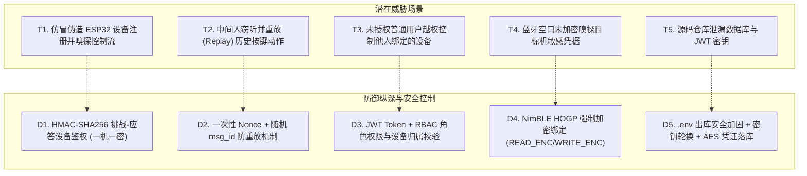
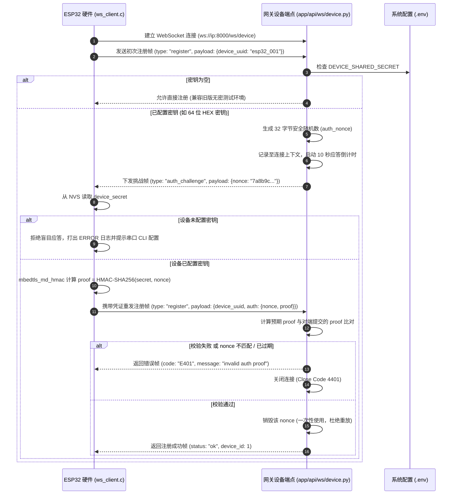

# 系统安全与权限架构设计 (Security & Authorization Architecture)

> **文档版本**：V2.1 工业级标准  
> **编写日期**：2026-10-26  
> **状态**：已落地并处于生产防御状态  

---

## 1. 威胁模型与安全边界 (Threat Modeling)

HID Gateway Platform 直接控制物理主机的键盘与鼠标输入，因此具备极高的安全敏感度。一旦攻击者攻破系统，可能直接在受控主机上注入恶意击键（如执行终端命令下载木马）。

本系统识别出以下 5 种核心威胁场景并设计了多层防御纵深：



---

## 2. 设备端接入安全：HMAC-SHA256 挑战-应答鉴权

为防止局域网内任意恶意客户端伪装成 `esp32_001` 抢占连接并接收下发的控制指令，系统实现了基于共享密钥的 **HMAC-SHA256 挑战-应答 (Challenge-Response)** 机制。

### 2.1 交互时序流程



### 2.2 防御特性与实施细节
1. **防重放 (Anti-Replay)**：服务端的 `auth_nonce` 具有唯一性与时效性（每连接独立生成，应答比对完成后立刻销毁）。任何窃听截获的 `register` 报文均无法用于发起第二次连接。
2. **密钥不落地传输**：在握手全程中，`device_secret` 从未在网络中以明文或密文传输，仅传输单向哈希计算结果。
3. **脱敏回显**：固件本地串口 CLI（`secret` 命令）与 Web 页面查询时，仅显示前 4 位字符，其余字符以 `****` 脱敏掩码显示。

---

## 3. 用户层认证与权限控制 (RBAC)

### 3.1 JWT Bearer Token 机制
- **算法**：HMAC-SHA256 (`HS256`)。
- **过期时间**：默认 1440 分钟（24 小时）。
- **载荷结构**：
  ```json
  {
    "sub": "1",           // 用户 ID (user_id)
    "exp": 1710086400,    // 过期时间戳
    "role": "admin"       // 角色标识 ("admin" | "user")
  }
  ```

### 3.2 角色权限矩阵

| 功能模块 | 接口端点 / 操作 | 普通用户 (`user`) | 系统管理员 (`admin`) |
|---|---|:---:|:---:|
| **设备监控** | 查看设备列表、状态、心跳、在线日志 | ✅ 仅限归属/公共设备 | ✅ 全网所有设备 |
| **设备控制** | 下发击键、鼠标位移、快捷键、触控板 | ✅ 仅限归属设备 | ✅ 任意在线设备 |
| **设备认领** | 将未分配设备绑定至自己账号 | ✅ 支持认领 | ✅ 支持认领与解绑 |
| **宏工作流** | 增删改查自己的宏定义与执行 | ✅ 仅限私有宏 | ✅ 任意用户宏 |
| **WiFi 管理** | 查看已存 WiFi、下发连网指令 | ✅ 支持 | ✅ 支持 |
| **WiFi 密码明文** | `GET /api/v2/devices/{uuid}/wifi-known/{ssid}/reveal` | ✅ 仅限设备所属者 | ✅ 全局支持 |
| **固件上传/推送** | `POST /api/v2/firmwares` / `push` | ❌ 无权操作 (403) | ✅ 拥有全权 |
| **用户与权限** | 创建账号、重置密码、修改权限 | ❌ 无权操作 (403) | ✅ 拥有全权 |

---

## 4. 蓝牙空口物理层安全 (BLE Security)

### 4.1 蓝牙配对安全模式
ESP32 NimBLE 协议栈配置为 **Security Mode 1, Level 2**（带加密的未认证配对 / Just Works），满足免除外设显示屏输入 PIN 码的同时提供完整的链路层加密。

### 4.2 GATT 特征与 CCCD 加密策略
在标准蓝牙 HID over GATT Profile (HOGP) 规范中，部分操作系统（尤其是 macOS）若检测到特征无需加密即可读取，会拒绝提升安全等级。
- **特征权限**：
  - `report_char`: `BLE_GATT_CHR_F_READ_ENC | BLE_GATT_CHR_F_WRITE_ENC`
  - `report_map`: `BLE_GATT_CHR_F_READ_ENC`
  - `hid_ctrl_pt`: `BLE_GATT_CHR_F_WRITE_ENC`
- **CCCD (Client Characteristic Configuration Descriptor)**：
  通过 NimBLE 私有 API `ble_gatts_set_clt_cfg_perm_flags(BLE_GATT_CHR_F_WRITE_ENC)` 全局强制订阅需要加密。未加密前主机尝试订阅即返回 `Insufficient Authentication`，促使操作系统自动触发安全配对流程。

### 4.3 密钥持久化防断连
配对成功后生成的 LTK（Long Term Key）由 NimBLE 自动写入 Flash 的 `nvs` 分区（`nimble_bond` 命名空间）。设备断电重启后自动载入原有 LTK，支持对端主机在 3 秒内免重配即刻恢复连接。

---

## 5. 凭证存储与安全合规最佳实践

1. **配置文件彻底出库**：
   - 生产与开发环境的 `.env` 文件严格列入 [`.gitignore`](file:///data/code/blue/py_web/.gitignore)，严禁提交至版本控制系统。
   - 仓库仅提供 [`.env.example`](file:///data/code/blue/py_web/.env.example) 作为配置项模板。
2. **凭据定期轮换指引**：
   - 生成 32 字节高强度随机 JWT 密钥：
     ```bash
     python -c "import secrets; print(secrets.token_hex(32))"
     ```
   - 生成设备预共享密钥：
     ```bash
     python -c "import secrets; print(secrets.token_hex(32))"
     ```
   - 通过串口 CLI 配置设备密钥（USB 直连模式）：
     ```text
     esp32> secret a1b2c3d4e5f6...
     [OK] Secret updated in NVS (a1b2****)
     esp32> reboot
     ```
3. **WiFi 密码存储加密**：
   - 写入 `device_wifi_known` 表的 WiFi 密码由 [`app/core/wifi_crypto.py`](file:///data/code/blue/py_web/app/core/wifi_crypto.py) 使用主密钥进行 AES-CBC 加密存储，数据库中严禁出现明文 WiFi 凭据。
