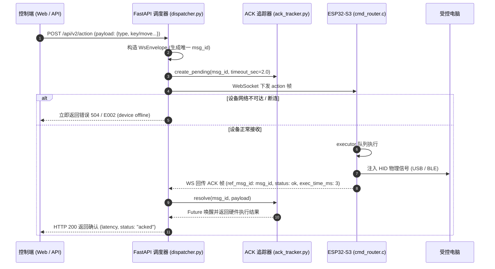
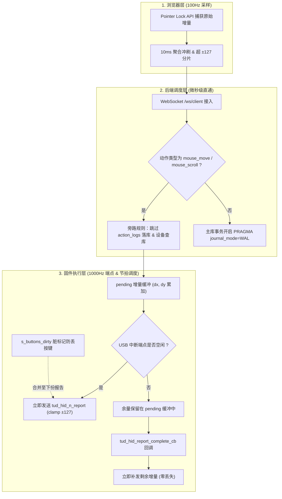

# 详细系统架构设计说明书 (System Architecture Specification)

> **系统名称**：HID Gateway Platform  
> **文档版本**：V2.1 工业级稳定版  
> **更新时间**：2026-10-26  
> **当前状态**：全链路生产运行状态（56 自动化测试全绿，软硬件及目标机端到端打通）

---

## 1. 架构总览与核心设计原则

HID Gateway Platform 是一个软硬件协同的高性能、跨平台外设中继与远程控制系统。其核心设计理念概括为：**零侵入、微秒级响应、协议统一、状态可查、高可用容灾**。

```
┌────────────────────────────────────────────────────────┐
│            Vue 3 前端系统 (vue-project/)                │
│  总览仪表盘 | 设备管理 | 动作控制台 | 虚拟触控板 | 宏库  │
└───────────────────────────┬────────────────────────────┘
                            │ HTTP REST / WebSocket (/ws/client)
┌───────────────────────────▼────────────────────────────┐
│          FastAPI 后端服务 (app/ - Port 8000)            │
│  - 调度派发器 (dispatcher.py) & ACK 追踪器              │
│  - 设备注册管理 (device_registry.py)                   │
│  - 数据库：SQLite (app.db WAL) / MySQL (生产容器)      │
│  - 静态资源托管：挂载托管 vue-project/dist/            │
└───────────────────────────┬────────────────────────────┘
                            │ 双向 WebSocket (/ws/device) + HMAC-SHA256
┌───────────────────────────▼────────────────────────────┐
│         ESP32-S3 固件系统 (ble_hid/ - ESP-IDF v5.4)    │
│  - 协议编解码 (protocol.c) & 单内核命令路由 (cmd_router.c) │
│  - 串口维护终端 (serial_cli.c 薄翻译层 → cmd_router) │
│  - 动作执行流水线 (executor.c)                         │
│  - USB HID 驱动 (TinyUSB: 1000Hz 键盘 + 鼠标)          │
│  - BLE HID 驱动 (NimBLE: 3 连接并发 / 15ms 节拍)       │
│  - 双槽 OTA 管理 (ota_mgr.c: sha256 校验 / 90s 自检回滚)│
└───────────────────────────┬────────────────────────────┘
                            │ USB 物理插头 / BLE 蓝牙 2.4GHz 无线
┌───────────────────────────▼────────────────────────────┐
│              受控目标主机电脑 (Mac / PC / NAS)          │
└────────────────────────────────────────────────────────┘
```

### 1.1 核心设计原则
1. **目标机零侵入 (Zero-Invasion)**：目标主机只需标准 USB 或蓝牙硬件接口，操作系统视 ESP32-S3 为标准物理键鼠，无须安装任何额外 Agent、驱动或依赖。
2. **单内核统一命令路由 (Single-Kernel Routing)**：ESP32 固件侧的所有指令源（云端 WebSocket、局域网 HTTP、本地串口 CLI）统一汇聚于 `cmd_router.c` 命令内核，共享同一份注册表、参数校验与错误码。
3. **数据分流与事务分级 (Stream vs Audit Tiering)**：高频瞬态数据（如 `mouse_move` 100+包/秒）走极速内存流，跳过数据库落库；配置变更、设备注册、低频按键走持久化事务，主库启用 SQLite WAL 模式避免事件循环阻塞。
4. **硬件状态机双向闭环 (Hardware-State Loop)**：每项操作具有唯一的 `msg_id`，设备端执行完毕后回传真实物理 ACK（包含执行耗时与硬件错误码），彻底杜绝假成功 ACK。

---

## 2. 系统分层架构与模块职责

### 2.1 交互表现层 (Presentation Layer - `vue-project/`)
- **技术栈**：Vue 3.5 + Vite 7 + Tailwind CSS + Element Plus + Pinia。
- **核心视图组件**：
  - **总览看板 (`dashboard.vue`)**：实时展示在线设备数、硬件规格指标、网络延迟走势与实时日志流。
  - **硬件控制台 (`console.vue`)**：浅色拟物 3D 机械键帽矩阵、统一输出目标选择器（USB 与 BLE 槽位联动）、多设备多选并发下发、终端实时输出流水。
  - **真实键鼠接管面板 (`MouseTakeoverPanel.vue`)**：利用浏览器 Pointer Lock API 捕获原始无加速度位移，实现 1000Hz 1:1 直通，带修饰键位掩码与按键防粘机制。
  - **平台感知体系**：根据当前选定目标电脑的平台标记（Win / Mac / Linux），动态切换对应的系统快捷键组（Mac Cmd+Tab / 桌面切换 vs Win Win+D / Alt+Tab）。
  - **宏工作流编辑器 (`macros.vue`)**：基于可视化步骤流水线，支持为不同平台单独配置步骤变体（Variants）。
  - **固件中心 (`firmware.vue`)**：固件拖拽上传、SHA-256 计算展示、版本管理与在线设备批量推送升级。

### 2.2 服务端中枢调度层 (Gateway Server - `app/`)
- **技术栈**：Python 3.10+ / FastAPI + SQLAlchemy 2.0 + SQLite (WAL) / MySQL 8.0。
- **模块分布**：
  - `app/api/ws/device.py`：设备 WebSocket 长连接服务端，管理设备注册握手、HMAC-SHA256 挑战应答鉴权、心跳维持、ACK 解析与 OTA 进度收集。
  - `app/api/ws/client.py`：客户端 WebSocket 端点，承接 Web 虚拟触控板与键鼠接管的高频低延迟数据流。
  - `app/services/dispatcher.py`：指令分发调度器。识别 `mouse_move` 流式动作，旁路跳过数据库持久化；对接 `ack_tracker` 进行异步 Future 跟踪；处理超时与错误透传。
  - `app/services/multi_target.py`：多设备并发派发器。通过 `asyncio.gather` 并发向多台硬件推送指令，并聚合汇总各设备执行状态。
  - `app/services/device_registry.py`：维护进程内存中在线设备的 WebSocket 连接句柄池。
  - `app/services/ack_tracker.py`：基于 `asyncio.Future` 实现跨请求周期的硬件物理 ACK 等待，支持毫秒级超时控制。
  - `app/database/models/`：ORM 数据模型，使用 `BigInteger().with_variant(Integer, "sqlite")` 兼容 SQLite 与 MySQL 自增主键。

### 2.3 硬件嵌入式固件层 (Firmware Layer - `ble_hid/`)
- **技术栈**：ESP-IDF v5.4.1 (C 语言)，芯片 ESP32-S3 (8MB PSRAM, 16MB Flash)。
- **核心组件**：
  - `cmd_router.c`：命令路由器。统管所有控制指令（`action`, `status`, `wifi.*`, `ble.*`, `transport.*`, `ota.*`）。
  - `serial_cli.c`：本地维护串口 CLI。作为薄翻译层将串口命令转换为 JSON 载荷注入 `cmd_router`。
  - `executor.c`：动作执行任务。独立 FreeRTOS 任务调度动作队列，处理组合键、单键、文本输入与延时。
  - `hid_usb.c`：TinyUSB 驱动。端点轮询率 1000Hz (bInterval 1ms)；位移增量累加合并缓冲；按键脏标记 `s_buttons_dirty` 机制防丢点击。
  - `hid_ble.c`：NimBLE 蓝牙驱动。支持最多 3 台主机并发连接（`s_conns[3]`）；连接数未满时持续广播；连接间隔（15ms）自适应节拍调度；HID 特征与 CCCD 强制加密解决 macOS 配对死循环；NimBLE NVS 持久化 LTK 密钥。
  - `ota_mgr.c`：双槽 OTA 管理器。流式分块下载、mbedtls SHA-256 哈希校验、90s 在线健康自检与看门狗自动回滚。

### 2.4 受控目标层 (Target Layer)
- 受控主机无需任何配置，支持线缆物理连接（USB）或蓝牙无线连接（BLE）。
- 现已实测覆盖 macOS 27、Windows 10/11 与 Linux (Debian / fnOS)。

---

## 3. 核心业务流程与时序架构

### 3.1 动作下发与精准确认时序 (Action Dispatch & ACK)



### 3.2 鼠标流式优化时序 (Mouse Streaming Pipeline)

在高频鼠标位移场景下（~100 包/秒），传统数据库写入会造成严重性能灾难。本系统采用三层穿透设计：



---

## 4. 关键架构设计决策与技术论证

### 4.1 为什么采用单内核命令路由 (`cmd_router.c`)
- **历史问题**：在早期架构中，串口 CLI 与网络端（WS / HTTP）分别调用不同的底层驱动，导致串口下发的配置（如 transport）只存内存、重启丢失；且串口动作在未连接蓝牙时静默丢弃，缺乏统一校验。
- **架构决策**：将串口 CLI 彻底降级为薄翻译层，解析命令行参数后组装为 JSON 统一投递给 `cmd_router_dispatch()`，保证所有入口（云端、局域网、串口）具有**完全一致的参数校验、错误码与 NVS 持久化行为**。

### 4.2 为什么将 SQLite 设置为 WAL 模式并旁路高频动作
- **痛点分析**：SQLite 默认的 `DELETE` 日志模式在每次 `commit` 时执行 `fsync`，耗时 1~15ms，高频鼠标移动会导致 asyncio 事件循环被完全卡死。
- **架构决策**：
  1. 在 `session.py` 中注入 connect 事件：`PRAGMA journal_mode=WAL` 与 `synchronous=NORMAL`，写操作直接追加 WAL 文件，实现微秒级提交并消除读写互斥。
  2. 在 `dispatcher.py` 中对瞬态鼠标流式动作实行免落库旁路，吞吐量由原先不足 50 actions/s 瞬间飙升至 **628 actions/s**。

### 4.3 为什么 BLE 必须采用强制加密（READ_ENC / WRITE_ENC）
- **痛点分析**：macOS 严格遵循蓝牙安全策略。若外设未将 HID 报告特征或 CCCD 标记为需要加密（Encryption Required），macOS 连接后无需配对即可订阅通知，但随后会因安全级别不足拒绝生成长期配对密钥（LTK），从而陷入“每 5 秒重连一次”的配对死循环。
- **架构决策**：在 GATT 注册时强制标记 `READ_ENC` 与 `WRITE_ENC`，促使 macOS 主机主动发起 SMP 加密配对并落盘 LTK，彻底解决断连循环。

### 4.4 为什么采用双槽 OTA 与 90 秒自检回滚
- **痛点分析**：远程物联网设备一旦固件升级失败（代码 Bug 导致死机或网络配置错误），将永久失联变砖，必须依赖人工拆壳线刷。
- **架构决策**：
  1. 划分 `ota_0` 与 `ota_1` 双槽位。
  2. 下载流式校验 SHA-256，不匹配则取消切换。
  3. 新固件启动后处于 `PENDING_VERIFY` 观察期，必须在 90s 内连入服务端完成注册方确认为健康；若超时或看门狗触发重启，Bootloader 自动回滚旧分区，实现 100% 远程免维护。
