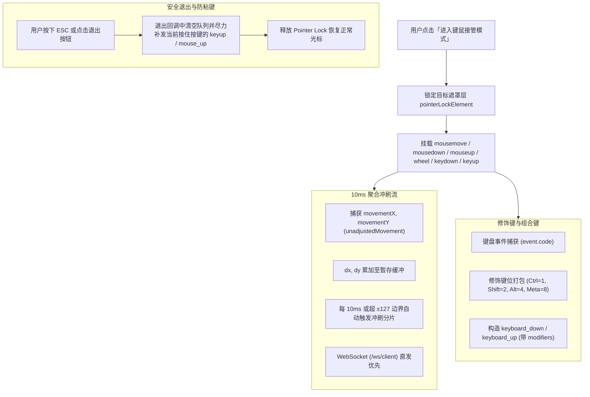

# 前端控制台系统详细设计说明书 (Frontend Web Subsystem)

> **模块路径**：`vue-project/`  
> **文档版本**：V2.1 工业级标准  
> **更新时间**：2026-10-26  
> **技术栈**：Vue 3.5 (Composition API) / Vite 7 / Tailwind CSS / Element Plus / Pinia

---

## 1. 系统定位与设计理念

前端控制台系统是操作员与底层硬件交互的**可视化作业中枢**。其核心目标是在浏览器环境中实现高沉浸感、低延迟、零闪烁的外设控制体验。

### 1.1 核心设计理念
1. **触感拟物与高对比度交互**：采用浅色 3D 机械键帽微拟物设计与 WCAG AAA 级对比度调色盘，摒弃发虚的文字效果，提供清脆明确的视觉反馈。
2. **多端直通接管 (Hardware Passthrough)**：深度利用现代 Web 标准的 Pointer Lock API，捕获鼠标原始无加速度相对位移与修饰键位掩码，实现 1000Hz 1:1 无损键鼠透传。
3. **平台全链路感知 (Platform-Awareness)**：受控主机的平台标记（Win / Mac / Linux）贯穿控制台快捷键、接管面板与宏编辑器，按受控端系统自动适配映射逻辑。
4. **多设备并发编排 (Multi-Target Orchestration)**：控制台支持多选硬件设备并发派发动作，并在实时终端中并行回显各设备的执行状态与毫秒级延迟。

---

## 2. 前端架构与目录规划

```
vue-project/
├── index.html               # SPA 入口 HTML
├── package.json             # 依赖声明 (Vue 3, Element Plus, vuedraggable, Pinia)
├── vite.config.js           # Vite 构建配置 (代理 /api 与 /ws 至后端)
└── src/
    ├── api/                 # REST API 请求模块 (axios 封装、JWT 拦截器)
    │   ├── auth.js          # 用户认证、登录与注册
    │   ├── devices.js       # 设备 CRUD、状态获取与分组管理
    │   ├── commands.js      # 动作下发、槽位绑定与主机平台标记 (host-meta)
    │   └── firmwares.js     # 固件上传、列表、推送与 OTA 进度查询
    ├── components/          # 公共组件库
    │   ├── MouseTakeoverPanel.vue # Pointer Lock 真实键鼠流式接管面板
    │   ├── DeviceDrawer.vue # 设备快捷配置抽屉 (WiFi、蓝牙、传输模式、重启)
    │   └── Navbar.vue       # 顶部导航栏与设备快速状态
    ├── layouts/             # 页面布局骨架
    │   └── DefaultLayout.vue# 侧边栏常驻导航、品牌渐变 Banner 与路由容器
    ├── router/              # Vue Router 路由定义与导航守卫
    ├── stores/              # Pinia 状态中心 (auth, device, settings)
    ├── styles/              # 全局样式规范、Tailwind 指令与 CSS 变量系统
    ├── utils/               # 工具类库 (WebSocket 客户端、键盘码映射、节流函数)
    └── views/               # 核心业务页面
        ├── dashboard.vue    # 仪表盘总览 (KPI 汇总、硬件指标、实时日志)
        ├── console.vue      # 硬件控制台 (机械键盘、输出目标、多设备派发、终端)
        ├── devices.vue      # 设备清单管理 (卡片/表格双视图、搜索筛选)
        ├── device-groups.vue# 设备分组编排
        ├── macros.vue       # 宏工作流编辑器 (拖拽流水线、平台变体分支)
        ├── firmware.vue     # 固件版本中心与 OTA 批量推送面板
        ├── logs.vue         # 动作审计日志中心 (多维筛选、耗时雷达)
        ├── trackpad.vue     # 移动端全手势触控板
        └── login.vue        # 登录与注册视图 (玻璃拟物、密码强度计)
```

---

## 3. 核心功能组件实现详解

### 3.1 真实键鼠流式接管面板 ([`MouseTakeoverPanel.vue`](file:///data/code/blue/py_web/vue-project/src/components/MouseTakeoverPanel.vue))



#### 关键实现特性
1. **真实物理直通 (Raw Input)**：优先请求 `unadjustedMovement: true` 参数，绕过 Windows / macOS 本地的鼠标加速度曲线，实现 1:1 的真实物理像素映射。
2. **修饰键位掩码 (Modifiers Mask)**：将 `Ctrl` (0x01)、`Shift` (0x02)、`Alt` (0x04)、`Meta/Cmd` (0x08) 压缩为一个字节位掩码，与按键原语同时投递，无需预置快捷键表即可支持任意复杂的系统级组合键（如 `Cmd+Option+Esc`）。
3. **防粘键主动释放 (Anti-Stick Release)**：当操作员按下 Esc 退出锁定或浏览器窗口失焦时，组件自动遍历当前处于按下状态的按键集合，批量补发抬起原语，彻底杜绝目标机粘键。

### 3.2 平台感知快捷键体系 ([`console.vue`](file:///data/code/blue/py_web/vue-project/src/views/console.vue))

在控制中枢中，前端维护了一套基于受控机平台元数据的动态快捷键映射：
- **输出目标卡片联动**：通过合并 `transport.get` + `ble.info` + `usb.info` + `ble.bonds` 四路数据，下拉框清晰展示当前输出通道（🔌 USB 线缆直连 或 各 BLE 蓝牙配对槽位，带在线及平台图标）。
- **平台快捷键动态切换**：
  - 当输出目标标记为 **macOS**：控制台快捷键矩阵呈现 `Cmd+Tab`（应用切换）、`Cmd+Space`（聚焦搜索）、`Cmd+Ctrl+←/→`（桌面切换）、`Cmd+Option+Esc`（强制退出）。
  - 当输出目标标记为 **Windows**：控制台自动切换为 `Win+D`（显示桌面）、`Win+Tab`（任务视图）、`Alt+Tab`（窗口切换）、`Ctrl+Shift+Esc`（任务管理器）。
  - 当输出目标标记为 **Linux**：适配为 `Ctrl+Alt+T`（打开终端）、`Super`（应用启动板）、`Ctrl+Alt+D`（桌面切换）。

### 3.3 宏工作流编辑器与平台变体分支 ([`macros.vue`](file:///data/code/blue/py_web/vue-project/src/views/macros.vue))

#### 1. 可视化拖拽编排
基于 `vuedraggable` 实现宏步骤流水线，包含 4 种颜色标识的积木节点：
- ⌨️ **按键动作 (Key Tap / Combo)**：支持指定修饰键与按键码。
- 🖱️ **鼠标动作 (Mouse Click / Move)**：支持左键、右键、中键点击与指定坐标移动。
- ⏱️ **延迟等待 (Delay)**：支持毫秒级精确暂停。
- ✍️ **文本注入 (Text Stream)**：输入任意长字符串并在目标机模拟键入。

#### 2. 跨平台变体 (Variants) 设计
宏定义结构中支持 `variants` 对象：
```json
{
  "name": "快速打开终端",
  "steps": [ /* 通用步骤 */ ],
  "variants": {
    "mac": [
      { "type": "combo", "keys": ["KEY_LEFTMETA", "KEY_SPACE"] },
      { "type": "delay", "duration_ms": 300 },
      { "type": "text", "text": "terminal\n" }
    ],
    "win": [
      { "type": "combo", "keys": ["KEY_LEFTMETA", "KEY_R"] },
      { "type": "delay", "duration_ms": 300 },
      { "type": "text", "text": "powershell\n" }
    ]
  }
}
```
运行时执行器自动探测目标槽位主机的平台标记，同组按平台自动选取变体下发，并在执行结果表中明确指示“已使用 macOS 变体”或“回退通用步骤”。

### 3.4 固件与 OTA 升级看板 ([`firmware.vue`](file:///data/code/blue/py_web/vue-project/src/views/firmware.vue))
- 支持拖拽上传固件文件，Web 端即时计算哈希并展示文件大小与创建时间。
- 列表支持多选在线设备，一键触发批量 OTA 推送。
- 集成环形进度条与实时升级日志轮询，可视化呈现设备下载流、校验流与重启引导状态。
