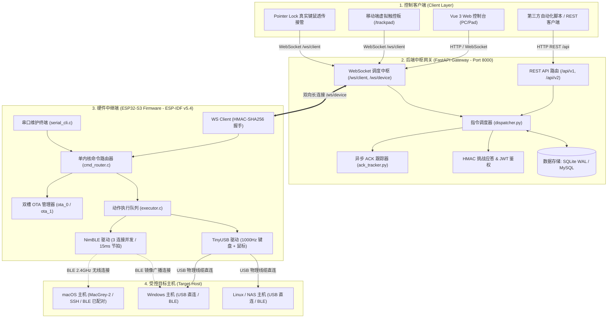

# HID Gateway Platform 文档中心

> **系统定位**：软硬件协同的局域网外设控制与中继中枢系统  
> **适用版本**：V2.1 工业级稳定版  
> **更新时间**：2026-10-26  
> **状态**：全链路稳定运行（自动化测试 56 用例全绿，已打通 Mac / Windows 受控机与 ESP32-S3 硬件）

---

## 📚 文档目录索引与知识拓扑

本文档库为 HID Gateway Platform 的权威设计与开发档案，涵盖从高层业务需求、端到端系统架构、通信协议规范到子系统细节设计、运维操作指南及历史攻关沉淀的全套资料。

```
docs/
├── README.md                                # 【当前】文档中心导航索引与全景蓝图
├── 01-requirements/                         # 1. 需求分析与规格说明
│   ├── product_requirements.md              # 产品需求文档 (PRD)：业务背景、功能清单、性能指标、环境约束
│   └── user_scenarios.md                    # 核心业务场景与典型操作流 (Web控制/键鼠接管/宏脚本/双槽OTA)
├── 02-architecture/                         # 2. 系统总体架构与设计
│   ├── system_architecture.md               # 总体系统架构：拓扑结构、分层设计、核心流程与关键设计决策
│   └── security_architecture.md             # 安全与权限架构：JWT、设备HMAC挑战应答、BLE强制加密、密钥管理
├── 03-protocols/                            # 3. 通信与交互协议规范
│   ├── protocol_v2_spec.md                  # V2.1 通信协议全量规范 (WsEnvelope 信封、调度路由、ACK、幂等去重)
│   └── api_reference.md                     # RESTful API 与 WebSocket 端点全集 (V1 / V2 / WS)
├── 04-subsystems/                           # 4. 子系统详细设计 (局部细节)
│   ├── backend_gateway.md                   # 后端网关详细设计 (FastAPI、调度器、ACK跟踪、SQLite WAL、多目标并发)
│   ├── esp32_firmware.md                    # ESP32-S3 固件详细设计 (单内核cmd_router、TinyUSB 1000Hz、NimBLE多连接、双槽OTA)
│   └── frontend_web.md                      # 前端控制台系统设计 (Vue 3、Pointer Lock 1000Hz接管、平台感知快捷键、宏流水线)
├── 05-operations/                           # 5. 运维部署与设备管理
│   ├── devices.md                           # 局域网与云端设备拓扑清单 (IP、账号、免密通道、连通性)
│   ├── deployment_guide.md                  # 多环境部署指南 (本地 SQLite 运行、Docker Compose 开发/生产编排)
│   └── firmware_flashing.md                 # 固件编译、烧录与 OTA 在线推送实操指南
└── 06-history-and-handover/                 # 6. 项目演化与交接沉淀
    ├── project_handover.md                  # 项目交付与交接报告 (历史演进、攻克的核心技术修复、避坑指南)
    └── changelog.md                         # 版本变更记录与里程碑发布历史
```

---

## 🌟 全链路系统全景架构



---

## 🧭 按角色快速查阅指南

### 1. 软件开发工程师（后端 / 前端）
- 了解接口与数据流：先读 [03-protocols/protocol_v2_spec.md](03-protocols/protocol_v2_spec.md) 与 [03-protocols/api_reference.md](03-protocols/api_reference.md)。
- 了解服务端调度与流控优化：阅读 [04-subsystems/backend_gateway.md](04-subsystems/backend_gateway.md)。
- 了解前端界面、键鼠直通接管与平台自适应：阅读 [04-subsystems/frontend_web.md](04-subsystems/frontend_web.md)。

### 2. 嵌入式固件工程师（ESP32 / HID）
- 了解固件架构与命令路由：阅读 [04-subsystems/esp32_firmware.md](04-subsystems/esp32_firmware.md)。
- 了解固件编译、调试与烧录：阅读 [05-operations/firmware_flashing.md](05-operations/firmware_flashing.md)。
- 了解关键历史 Bug（蓝牙断连循环、Tmr Svc 栈溢出、端点忙丢包）：查阅 [06-history-and-handover/project_handover.md](06-history-and-handover/project_handover.md)。

### 3. 系统运维与测试工程师
- 查阅现有设备网络与账号清单：阅读 [05-operations/devices.md](05-operations/devices.md)。
- 本地与 Docker 环境一键启动部署：阅读 [05-operations/deployment_guide.md](05-operations/deployment_guide.md)。
- 全量自动化测试与冒烟测试验证：查阅 [06-history-and-handover/project_handover.md](06-history-and-handover/project_handover.md) 中的测试说明。
